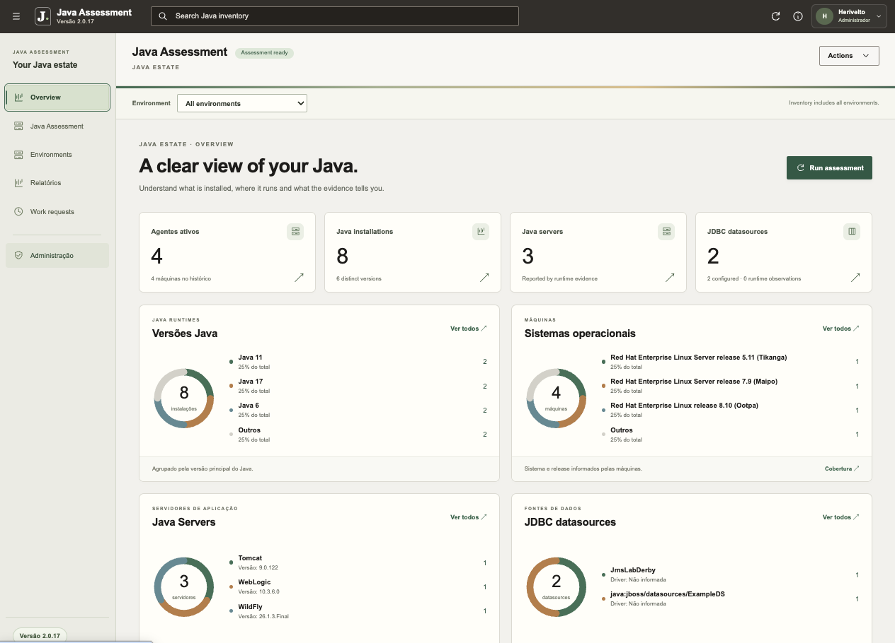

# Java Assessment

Descoberta e inventário do ambiente Java na infraestrutura do cliente. A versão **2.1.24**, preparada para atualização pela console, reúne dashboard, agente Linux e banco SQLite local, com organização por ambiente e máquina.



Esta entrega reúne [configurações Spring/JDBC](docs/SPRING_DISCOVERY.md), [driver WebLogic por processo](docs/JDBC_DRIVER_RESOLUTION.md) e [Tomcat/JBoss](docs/TOMCAT_JBOSS_DISCOVERY.md). Excel, Mapa de bancos e o ajuste do driver provável estão nas [notas da 2.1.18](docs/RELEASE_2.1.18.md).

## Nova entrega — 2.1.24

Melhor identificação de drivers JDBC no WebLogic, associação das configurações ao domínio correto, reconhecimento de `ojdbc14` e diagnóstico detalhado de inspeção incompleta. [Notas](docs/RELEASE_2.1.24.md) · [Pacotes](install/v2.1.24/README.md) · [Validação](docs/validation/console-release-2.1.24.md).

**Atualize também os agentes e execute uma nova coleta.** Atualizar somente o dashboard não altera os inventários anteriores. As correções estão no coletor; confira a elegibilidade em **Revisar agentes**. A ponte interna 2.1.23 não exige instalação manual.

## Entrega anterior preservada — 2.1.22

Cadastro sem teto fixo de 1.000 máquinas, códigos com até 100.000 usos, limpeza dos códigos inelegíveis e lista paginada por ambiente. [Notas](docs/RELEASE_2.1.22.md) · [Pacotes](install/v2.1.22/README.md).

A remoção dos limites de cadastro ocorreu no dashboard e não exigiu agente novo. Os limites de lote e recursos do servidor permanecem; não há promessa de escala ilimitada.

## Entrega anterior preservada — 2.1.20

A tabela e os detalhes de **Datasources JDBC** exibem **Profile/contexto**, diferenciando nomes iguais em perfis distintos. A informação vem do inventário existente; não há mudança funcional no agente. [Notas](docs/RELEASE_2.1.20.md) · [Pacotes](install/v2.1.20/README.md) · [Validação](docs/validation/console-release-2.1.20.md).

Use o web-update em **Administração → Atualização do dashboard**. **Atualizar o dashboard não atualiza agentes automaticamente**; revise versões e elegibilidade no painel e atualize separadamente se desejar alinhar a versão.

## Entrega anterior preservada — 2.1.18

**Administração → Exportar inventário** inclui Excel (.xlsx), com abas por tipo, e **Mapa de bancos**, para cruzar datasources, destinos e aplicações com outro inventário. JSON e CSV completo continuam disponíveis. A tela só apresenta driver provável quando o candidato único estava no classpath. [Notas](docs/RELEASE_2.1.18.md) · [Formatos](docs/INVENTORY_EXPORT.md) · [Instaladores](install/v2.1.18/README.md).

Use o [web-update 2.1.18](install/v2.1.18/assessment-dashboard-web-update-2.1.18.zip) pela console a partir da 2.1.14 ou 2.1.16. **Atualizar o dashboard não atualiza agentes automaticamente.** Não houve mudança funcional no agente; os novos formatos usam dados existentes. Para alinhar versões, revise os agentes e atualize-os separadamente pelo painel. [Validação](docs/validation/console-release-2.1.18.md).

## Entrega anterior preservada — 2.1.16

**Administração → Exportar inventário** permite escolher JSON ou CSV e gera um ZIP com um único arquivo de dados técnicos, vínculos e evidências da coleta para análise em outra aplicação. Não inclui cadastros de usuários, credenciais ou chaves; nomes, IPs e caminhos continuam identificáveis. [Formato do pacote](docs/INVENTORY_EXPORT.md) · [Notas](docs/RELEASE_2.1.16.md) · [Instaladores](install/v2.1.16/README.md).

Envie o [web-update 2.1.16](install/v2.1.16/assessment-dashboard-web-update-2.1.16.zip) pela console. **Atualize também os agentes separadamente pelo painel.** A exportação pode aproveitar os dados já coletados, sem exigir nova coleta. [Validação da atualização](docs/validation/console-release-2.1.16.md).

## Recursos

- Visão geral com quatro distribuições compactas: Java, sistemas operacionais, servidores por produto/versão e datasources por nome/versão do driver; máquinas em lista com busca e dez itens por página.
- Instalações Java, incluindo runtimes sem compilador quando há evidência de uso por aplicação.
- Aplicações, processos, servidores Java, bibliotecas e datasources JDBC por configuração suportada.
- JAR e versão do driver JDBC por datasource WebLogic, Tomcat e JBoss/WildFly, com classe exata, precedência, origem e indicação de candidatos ou inspeção incompleta.
- Contas individuais com email e senha, perfis Administrador e Leitura e troca de senha no primeiro acesso.
- Relatórios de máquinas, Java, servidores, JDBC e ambientes, com filtros combinados, seleção de colunas e exportação PDF/CSV.
- JDBC em todos os relatórios, com datasource, driver, versão e destino configurado do banco (host/IP, porta e banco/serviço), também nas exportações PDF/CSV.
- Exportação de um CSV único do inventário por ambiente, máquina ou todos os ambientes.
- Ações de máquina, revogação e desinstalação controlada do agente.
- Atualização de agentes compatíveis por HTTPS, individualmente ou por ambiente, com assinatura e verificação.
- Atualização do próprio dashboard pela Administração, com upload de ZIP assinado, confirmação de reinício, acompanhamento e restauração compatível.
- Histórico de coletas e atualizações em **Solicitações**, incluindo progresso, observações e assessment após atualizar.
- Interface em português e indicadores de agentes conectados/desconectados por ambiente.
- Instalação pelo ZIP ou por comandos e scripts curl/wget gerados no dashboard, com acesso de instalação administrado por ambiente.
- Descoberta passiva de Spring Boot, configurações de datasource e drivers; integração opcional para receber a versão real do banco informada pela aplicação.
- Filtro **Sem comunicação** e exclusão individual ou em lote do inventário, com confirmação e revalidação do último contato.

O agente inicia a comunicação HTTPS com o dashboard. Contato e consulta de tarefas são separados da varredura: sem tarefa, não há novo assessment. Os dados permanecem na instalação do cliente.

## Relatórios

A área **Relatórios** transforma o inventário recebido em consultas para análise e compartilhamento. Escolha o modelo, aplique filtros e selecione as colunas antes de exportar.

| Modelo | Principais informações |
| --- | --- |
| Máquinas | Ambiente, IP, sistema operacional, versões Java, servidores e JDBC da máquina |
| Java | Máquina, ambiente, IP, versão, Java home, fornecedor e JDBC da máquina |
| Servidores Java | Máquina, ambiente, IP, produto, nome e versão do servidor, Java associado, sistema operacional e JDBC do servidor |
| JDBC | Datasource/nome JNDI, banco, host/IP e porta de destino, banco/serviço configurado, driver, versão, classe, máquina, IP, ambiente, servidores e aplicações associados |
| Resumo por ambiente | Quantidades de máquinas, instalações Java, servidores e datasources, com resumo JDBC |

Combine os filtros de máquinas e servidores com os de JDBC: presença de datasources, nome/JNDI, banco, host/IP, porta, banco/serviço, driver e versão, classe, referência do driver, servidor, aplicação, tipo de recurso e estado. Os campos oferecem sugestões do inventário e aceitam digitação. Por exemplo, consulte máquinas com determinada versão do WebLogic ou datasources de uma aplicação com um driver específico.

O JDBC de um servidor usa as associações registradas no inventário. Para consultar também os recursos encontrados na mesma máquina, adicione a coluna **JDBC da máquina**. A versão Java associada ao servidor é obtida pela correspondência do Java home registrado. Campos sem evidência permanecem sem informação.

PDF e CSV respeitam os mesmos filtros e colunas, incluindo todas as páginas do resultado. As exportações têm limite de 10.000 registros e 8.192 caracteres por célula; refine os filtros para consultas maiores. Os relatórios não incluem URLs JDBC, senhas ou tokens. O estado de um datasource descreve a evidência coletada e não confirma conectividade com o banco.

## Operação do inventário

Em **Java Assessment → Máquinas → Sem comunicação**, filtre por ambiente e tempo sem contato: 5 minutos, 24 horas, 7 dias ou 30 dias. Administradores podem selecionar máquinas e usar **Excluir do inventário**. A confirmação verifica novamente o contato e preserva máquinas que voltaram a comunicar ou tiveram alterações.

A exclusão remove o cadastro e os dados dos totais, relatórios, exportações e listas de atualização, sem mover a máquina para “Sem ambiente”. Mantém apenas o bloqueio técnico da credencial antiga e a auditoria administrativa limitada. Não desinstala serviços na máquina e não ocorre automaticamente por falta de comunicação. Veja [a documentação da limpeza](docs/MACHINE_CLEANUP.md).

A inspeção de arquivos Java vem habilitada por padrão, respeitando exceções configuradas, limites de tempo e leitura. Diretórios internos do agente, incluindo `java-assessment-runtime`, ficam fora do inventário. A versão da JVM do próprio agente continua visível. Para Spring Boot, consulte [a cobertura passiva e seus limites](docs/SPRING_DISCOVERY.md) e [a integração opcional](docs/SPRING_INTEGRATION.md); a versão do driver não é usada para inferir a versão do banco.

## Componentes e requisitos

| Componente | Função | Requisitos |
| --- | --- | --- |
| Dashboard | Inventário, ambientes, coletas, usuários e administração | Enterprise Linux 8+ compatível, 64 bits, systemd, JDK 17+ |
| Agente | Descoberta com escopo, exclusões e limites configuráveis | Linux e JVM existente compatível; serviço instalado com sudo/root |
| SQLite | Inventário, configurações e histórico | Embarcado; sem serviço de banco separado |

Uma instalação nova do dashboard configura `Xms=Xmx=1536m` e limite do serviço de 2 GiB. O coletor usa `Xms16m` e `Xmx96m`; memória nativa e subprocessos são adicionais. Dimensionamento e cobertura dependem do ambiente real.

## Gerar o instalador a partir do Git

Na raiz deste repositório, com Python 3 e OpenSSL disponíveis:

```sh
# Recupera somente os artefatos públicos assinados do instalador publicado.
unzip -o install/v2.1.20/assessment-dashboard-installer-2.1.20.zip 'dist/*' -d .
python3 -B ops/prepare-beta-dependencies.py --check
python3 -B dashboard-installer/build.py --with-source
```

Os resultados ficam em `dist/assessment-dashboard-installer-2.1.20.zip` e `dist/assessment-dashboard-source-2.1.20.zip`, com arquivos SHA-256. O build usa as bibliotecas fixadas, o agente genérico e o catálogo público assinado incluídos no repositório. Não exige arquivos da máquina de desenvolvimento nem a chave privada de assinatura.

O pacote do agente versionado em `dist/assessment-collector.zip` é genérico e não contém identidade cadastrada. O catálogo extraído em `dist/` inclui os pacotes completos e as rotas de migração. O build verifica assinaturas, chave pública e integridade antes de empacotar. Alterações nos arquivos executáveis exigem uma nova entrega assinada; o build não assina nem substitui a confiança instalada.

## Entrega anterior preservada — 2.1.14

A [2.1.14](install/v2.1.14/README.md) amplia os limites de classpath e mostra JAR/versão prováveis quando os processos concordam com um único candidato. [Notas](docs/RELEASE_2.1.14.md) · [Validação 2.1.12 → 2.1.14](docs/validation/console-release-2.1.14.md).

Envie **assessment-dashboard-web-update-2.1.14.zip** em Administração → Atualização do dashboard. **Atualize também os agentes e solicite nova coleta** para os novos limites. A ponte 2.1.13 é interna.

## Entrega anterior preservada — 2.1.12

A [2.1.12](install/v2.1.12/README.md) incorpora as correções de jsvc, configurações externas, manifestos assinados e observações da coleta. `/opt` volta às inclusões padrão; listas salvas não são migradas. [Notas](docs/RELEASE_2.1.12.md) · [Validação da rota direta 2.1.8 → 2.1.12](docs/validation/console-release-2.1.12.md).

Envie **assessment-dashboard-web-update-2.1.12.zip** em Administração → Atualização do dashboard. **Atualize os agentes separadamente e solicite nova coleta.** Não é necessário instalar 2.1.10; a ponte 2.1.11 é interna.

Padrões de coleta na 2.1.12: incluídos `/usr/java`, `/usr/lib/jvm`, `/opt`, `/u01`, `/etc/config`, `/prd1`; excluídos `/proc`, `/sys`, `/dev`, `/tmp`. Listas salvas não mudam. Veja [o registro das correções](docs/CORRECTIONS_2.1.10_PENDING.md).

## Entrega anterior preservada — 2.1.10

A [2.1.10](install/v2.1.10/README.md) consolida configuração externa Spring, resolução JDBC por processo no WebLogic, classloaders/propriedades/contextos Tomcat e módulos/deployments/JNDI do JBoss. Envie o **assessment-dashboard-web-update-2.1.10.zip** em Administração → Atualização do dashboard. [Notas](docs/RELEASE_2.1.10.md) · [Validação](docs/validation/console-release-2.1.10.md).

**Atualize também os agentes**, separadamente, e solicite nova coleta. A 2.1.9 é ponte interna, sem instalação manual intermediária. Confira a elegibilidade pelo painel.

## Entrega anterior — 2.1.8

A [2.1.8](install/v2.1.8/README.md) deixa o agente mais rápido e preciso: versão real das JVMs em execução (inclusive Java atualizado em disco com a aplicação rodando), JARs internos do Spring Boot sem descompactar, mais drivers e pools, placeholders `${...}`, JBoss domain/XA/módulos, pools do Tomcat e alias TNS. No dashboard, status de suporte de Java e servidores, painel de riscos e visão "quem acessa cada banco". Envie o **pacote web-update** em Administração → Atualização do dashboard. [Notas](docs/RELEASE_2.1.8.md).

**Atualize os agentes separadamente e faça nova coleta** para obter os novos campos.

## Entrega anterior — 2.1.6

A [2.1.6](install/v2.1.6/README.md) associa o JAR ao datasource Spring e libera o lote quando uma máquina não inicia em cinco minutos na sua vez. Envie o **pacote web-update** em Administração → Atualização do dashboard; revise e confirme Atualizar e reiniciar. [Notas e teste](docs/RELEASE_2.1.6.md).

**Atualize os agentes separadamente e faça nova coleta** para obter os novos campos Spring. O dashboard de laboratório permanece na 2.1.4 até o teste do operador; versões anteriores continuam preservadas.

## Entrega de laboratório 2.1.4

A [2.1.4](install/v2.1.4/README.md) separa **Arquivo JAR** e **Versão** em Bibliotecas Java. O dashboard pode ser atualizado pelo pacote web assinado; agentes 2.1.2 já fornecem os campos necessários e não precisam ser atualizados para este ajuste. Publicar o dashboard não atualiza agentes automaticamente. [Notas e compatibilidade](docs/RELEASE_2.1.4.md).

## Entrega de laboratório 2.1.2

A [2.1.2](install/v2.1.2/README.md) melhora a descoberta Oracle JDBC e acrescenta evidências aos relatórios. Dashboards 2.1.0 com o executor instalado usam o pacote web-update pela Administração. A versão 2.1.0 permanece disponível abaixo para primeira adoção e instalação estável. Consulte [o guia JDBC](docs/JDBC_DRIVER_RESOLUTION.md) e [as validações](docs/validation/jdbc-driver-resolution-2026-10-19.md). Atualize os agentes separadamente e solicite nova coleta.

## Atualizar dashboard existente

A primeira adoção da **2.1.0** usa o [pacote de atualização por script](install/v2.1.0/README.md), que instala o executor independente. O deploy **2.0.57 → 2.1.0** foi confirmado no laboratório, preservando banco, contas, configuração e certificados.

```sh
unzip assessment-dashboard-update-2.1.0.zip -d dashboard-update-2.1.0
cd dashboard-update-2.1.0
sudo /bin/sh atualizar-dashboard.sh
```

Extraia em uma pasta nova. O script verifica os arquivos, cria backup e confirma o serviço por HTTPS. O instalador completo é destinado a servidores novos.

Nas próximas versões compatíveis, abra **Administração → Atualização do dashboard**, envie `assessment-dashboard-web-update-X.Y.Z.zip`, confira a preparação e confirme **Atualizar e reiniciar** com sua senha. É possível cancelar antes da aplicação e restaurar a última versão quando compatível. Falhas de inicialização provocam tentativa automática de retorno, preservando o banco atual. Se o serviço não conseguir iniciar, poderá ser necessário diagnóstico no servidor. Veja [o guia operacional](docs/DASHBOARD_SELF_UPDATE.md).

O pacote web da 2.1.0 não instala o executor em uma versão antiga e não pode ser reaplicado na própria 2.1.0. O painel aceita somente versões posteriores e origens compatíveis com o manifesto assinado.

**Atualize também os agentes:** o dashboard não os atualiza automaticamente. As rotas diretas **2.0.53 e 2.0.57 → 2.1.0** foram verificadas com os binários originais e pacotes assinados em testes com adaptadores de sistema/rede. O operador confirmou a atualização do laboratório; confira a elegibilidade no painel e comece por uma máquina em cada ambiente. Consulte [as evidências e seus limites](docs/validation/dashboard-self-update-2026-10-16.md).

A [2.0.57 permanece preservada](install/v2.0.57/README.md), incluindo os instaladores originais e backup anterior ao novo atualizador.

## Instalar no cliente

O [diretório install](install/README.md) reúne o [manual ilustrado](install/Manual.pdf), o [guia de instalação](install/Guia-instalacao.pdf) e o instalador pronto da versão 2.1.0, com seu SHA-256. Os PDFs usam nomes estáveis e comandos com `X.Y.Z` para a versão escolhida. Para as funcionalidades mais recentes, consulte também as notas da versão e os guias específicos abaixo.

**Para uma instalação nova.** O ZIP não deve ser executado sobre um dashboard existente para atualizá-lo. Na VM destinada ao dashboard, após transferir o instalador e seu SHA-256:

```sh
sha256sum -c assessment-dashboard-installer-2.1.0.zip.sha256
unzip assessment-dashboard-installer-2.1.0.zip -d dashboard-installer-2.1.0
cd dashboard-installer-2.1.0
./install.sh \
  --public-url https://dashboard.exemplo.com \
  --admin-name "Administrador" \
  --admin-email admin@exemplo.com
```

Substitua o endereço e a identidade pelos valores do cliente. O instalador fornece uma senha temporária e exige sua troca no primeiro acesso. A equipe deve configurar a confiança no certificado HTTPS e permitir acesso à porta 443. O endereço pode ser privado.

Crie os ambientes e use **Baixar agente** no dashboard do cliente. A aba **Instalar via terminal** gera comandos e scripts curl/wget: execute o download como usuário normal e depois o comando com sudo que ele apresentar. O acesso permanece válido até renovação/desativação; trate o script como credencial. A opção **Baixar ZIP** continua disponível. Veja [o guia do acesso de instalação](docs/ENVIRONMENT_INSTALL_ACCESS.md).

Para o ZIP, na máquina monitorada, extraia o ZIP em uma pasta nova e execute:

```sh
sudo /bin/sh ./install.sh --system-root
```

O destino operacional é `/opt/java-assessment-collector`, independentemente da pasta de extração ou do nome do usuário. **Atenção: publicar o dashboard não atualiza os agentes automaticamente.** Use **Revisar agentes** para consultar elegibilidade: instalações V3 recebem atualização completa e perfis legados conhecidos a partir de 1.5.12 podem usar migração pelo painel. A versão sozinha não comprova compatibilidade. Instalações sem suporte elegível precisam do instalador completo configurado para o ambiente, preservando cadastro, configuração e CA. Comece por uma máquina e mantenha o assessment após atualização habilitado. Acompanhe em **Solicitações** e confirme a versão da máquina.

## Desenvolvimento e validação local

Com JDK 17+ e Node.js no ambiente:

```sh
export JAVA_HOME=/caminho/do/jdk17
/bin/sh ops/test-source.sh
python3 -B tests/agent-update-installer-test.py
python3 -B tests/dashboard_installer_test.py
BETA_INSTALLER_RUNTIME_TEST=1 python3 -B tests/beta-installer-test.py
```

As verificações HTTP/HTTPS usam loopback e diretórios temporários. Não atualizam VMs. `ops/test-source.sh` não executa os testes pesados de carga ou de diretórios.

Para compilar o agente com alvo Java 6, configure `ASSESSMENT_ECJ_JAR` com um Eclipse Compiler compatível, como ECJ 3.33.0. Os testes executados em JDK 17 não comprovam execução em Java 6 ou Linux de 32 bits.

Os testes de navegador usam Playwright e Chrome. Configure `NODE`, `NODE_PATH`, `PLAYWRIGHT_MODULE` ou `BROWSER_CHANNEL` conforme o ambiente. `BETA_LOAD=0 /bin/sh ops/test-beta.sh` executa a suíte histórica de interface sem o teste de carga.

## Documentação

- [Notas da entrega de laboratório 2.1.2](docs/RELEASE_2.1.2.md)
- [Descoberta de versões dos drivers JDBC](docs/JDBC_DRIVER_RESOLUTION.md)

- [Processo de release e aviso obrigatório de atualização dos agentes](docs/RELEASE_PROCESS.md)
- [Melhorias planejadas](docs/TODO.md)
- [Plano do atualizador completo a partir da 1.5.12 e assessment após atualizar](docs/superpowers/plans/2026-10-14-full-agent-update.md) — disponível para instalações elegíveis; consulte os resultados e limites de validação nas notas da versão.
- [Visão funcional, operação e limites](docs/SOLUTION.md)
- [Mudanças e validação da 2.1.0](docs/RELEASE_2.1.0.md)
- [Atualização do dashboard pela Administração](docs/DASHBOARD_SELF_UPDATE.md)
- [Instalação e configuração](dashboard-installer/GUIA_INSTALACAO.md)
- [Opções do instalador](dashboard-installer/README.md)
- [Instalação do coletor](collector/INSTALL.md)
- [Instalação e recuperação de agentes com Ansible e wget, por ambiente](install/ansible/README.md)
- [Atualização de agentes em lotes com Ansible, pela API e sem SSH](install/ansible/UPDATE.md)
- [Arquitetura e contrato HTTP](CONTRACT.md)
- [Reconstrução do pacote de fontes](dashboard-installer/README-SOURCE.md)
- [Atualização completa V3 e assessment posterior](docs/AGENT_UPDATE_V3.md)
- [Validações e gates antes de publicar](docs/validation/full-agent-update.md)
- [Migração e backup](dashboard-installer/BETA_MIGRATION.md)

Os nomes de alguns scripts e documentos mantêm `beta` por compatibilidade com a estrutura anterior. A entrega preparada atual é 2.1.20; a 2.1.0 permanece preservada. Relatórios históricos descrevem somente o cenário e a versão em que foram produzidos.

Configurações privadas, chaves, inventário, logs, pacotes de ambientes e ferramentas específicas do laboratório ficam fora do Git. Publicar código neste repositório não instala nem atualiza servidores ou agentes.

## Licença

[MIT](LICENSE). As dependências mantêm suas próprias licenças em [lib/licenses](lib/licenses), com versões e checksums em [dependencies-lock.json](lib/dependencies-lock.json).
